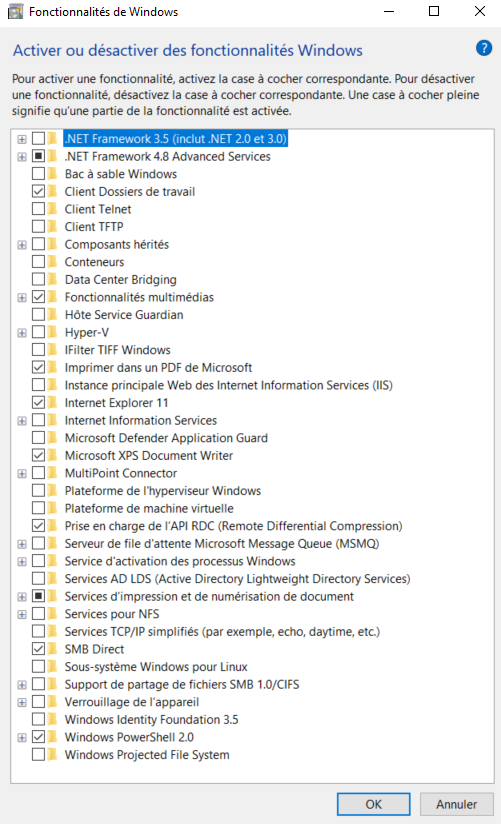

# Windows


- [Installes chocolatey](https://chocolatey.org/install)

Lances `PowerShell` en tant qu'administrateur puis executes : 

```bash
Get-ExecutionPolicy
```
Si la commande retourne `Restricted` alors executes : 

```bash
Set-ExecutionPolicy AllSigned
```

Puis executes : 

```bash
Set-ExecutionPolicy Bypass -Scope Process -Force; [System.Net.ServicePointManager]::SecurityProtocol = [System.Net.ServicePointManager]::SecurityProtocol -bor 3072; iex ((New-Object System.Net.WebClient).DownloadString('https://community.chocolatey.org/install.ps1'))
```

En cas d’erreur penses à desactiver l’antivirus.

Si pas des erreurs alors tu es prêt à utiliser Chocolatey, pour s'assurer le bon fonctionnement executes la commande ci-dessous afin de voir la version installée : 

```bash
choco
```

- [Installes virtuallbox](https://community.chocolatey.org/packages/virtualbox)

Lances `PowerShell` en tant qu'administrateur puis executes : 

```bash
choco install virtualbox --version=7.1.4 -y 
```

- [Installes vagrant](https://community.chocolatey.org/packages/vagrant)

Lances `PowerShell` en tant qu'administrateur puis executes : 

```bash
choco install vagrant --version=2.4.5 -y 
```

- [Installes git](https://community.chocolatey.org/packages/git)

Lances `PowerShell` en tant qu'administrateur puis executes : 

```bash
choco install git -y
```

- [Installes Visual Studio Code](https://community.chocolatey.org/packages/vscode)

Lances `PowerShell` en tant qu'administrateur puis executes : 

```bash
choco install vscode -y 
```

- [Installes Helm](https://community.chocolatey.org/packages/kubernetes-helm)

Lances `PowerShell` en tant qu'administrateur puis executes : 

```bash
choco install kubernetes-helm --version=3.17.2 -y
```


- [Installes kubectl](https://community.chocolatey.org/packages/kubernetes-cli)

Lances `PowerShell` en tant qu'administrateur puis executes : 

```bash
choco install kubernetes-cli --version=1.33.0 -y 
```

Pour tester executes : 

```bash
kubectl version --client
```

Pour plus d'information concernant l'autocompletion des commandes kubectl, consultes la documentation [ici](https://kubernetes.io/docs/reference/kubectl/quick-reference/#kubectl-autocomplete).

**Pour faire de la virtualisation sur ta machine, penses à l’activer dans le bios et desactiver les autres outils de virtualisation dans les fonctionnalités Windows :**  

*`
Hyper-V,
Sous-sytème Windows pour Linux,
Docker Desktop,
Plateforme de machine virtuelle, 
Plateforme de l’hyperviseur Windows.
`*



---

[Retour en arrière](../README.md)